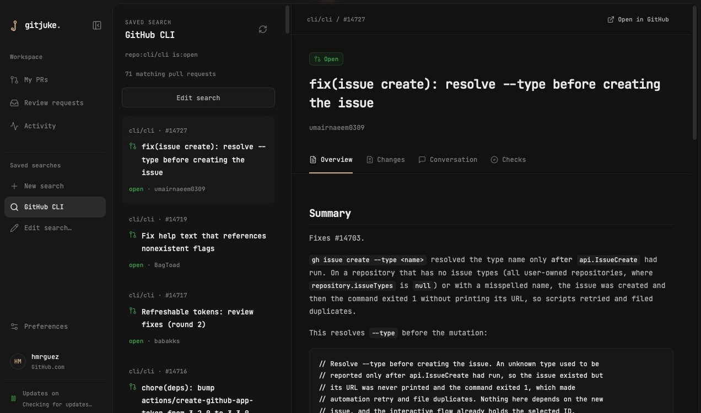
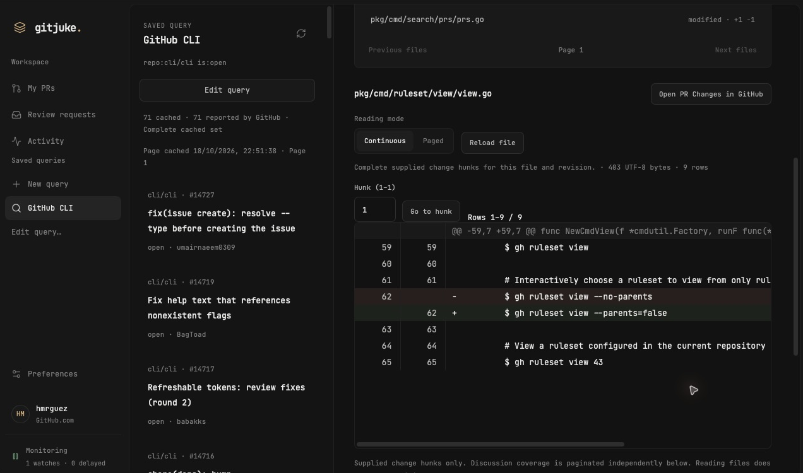

# GitJuke

Your GitHub pull requests, with room to read.

GitJuke is a macOS app for keeping up with your PRs, review requests, and the conversations around them. Browse changes, follow discussions, and check build results in one place.

## A desk for your reviews

- **Keep your queue close.** Find your open PRs and review requests, or save a GitHub search you come back to often.
- **Read the whole change.** Explore diffs, comments, review threads, and published PR stacks.
- **Follow what happens next.** Catch up on personal activity, inspect checks, and open GitHub Actions job logs.
- **Settle in.** Choose Graphite or Paper, enlarge the text, and navigate with the keyboard.

GitJuke is read-only on GitHub. It doesn't post comments, submit reviews, or merge PRs. It uses your existing GitHub CLI login and keeps its cache and preferences on your Mac. Notifications and launch at login are optional.

## A closer look

Both screenshots show the native app reading public pull requests from [GitHub CLI](https://github.com/cli/cli), with real titles, authors, and code. [Screenshot details](docs/screenshots/README.md).

## Try it

GitJuke is an early development build for **Apple Silicon Macs running macOS 15 or later**. Some features are still being tested.

1. [Download GitJuke v0.1.0](https://github.com/hmrguez/GitJuke/releases/download/v0.1.0/GitJuke_0.1.0_aarch64.dmg). The app is Developer ID signed and notarized by Apple.
2. Open the DMG and drag **GitJuke.app** into **Applications**, then eject the disk image.
3. Install [GitHub CLI](https://cli.github.com/) if needed, then run `gh auth login` in Terminal to sign in to GitHub.
4. Open **GitJuke** from Applications. It uses your GitHub CLI login.

See [all releases and checksums](https://github.com/hmrguez/GitJuke/releases) or follow the [development setup](docs/development.md) to build from source. To sign your own build, see [releasing and signing](docs/releasing.md).

## Learn more

- [Development](docs/development.md) — setup, commands, and local builds.
- [Releasing and signing](docs/releasing.md) — official releases and signing your own builds.
- [Technical overview](docs/architecture.md) — how the app reads GitHub and stores data.
- [Project status](docs/status.md) — what's implemented and what still needs verification.
- [Documentation index](docs/README.md) — design notes and detailed engineering records.
